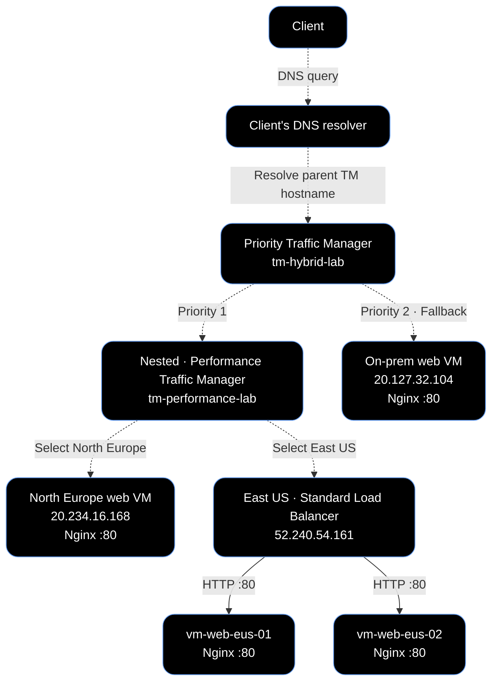
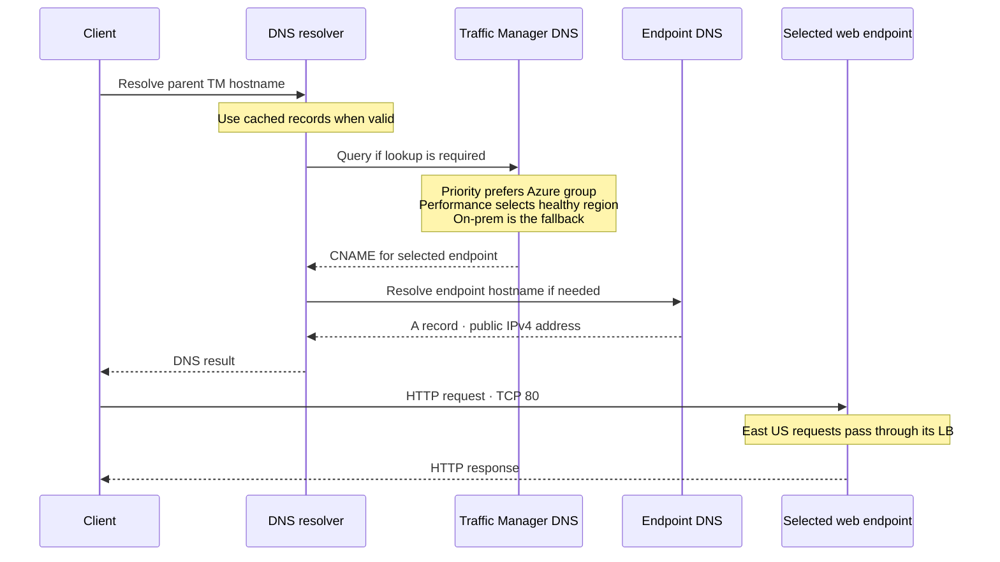

# Azure Traffic Manager — Multi-Region Hybrid Web Lab

## Overview

This lab combines two Azure regions with a simulated on-premises fallback.

A parent Traffic Manager profile uses Priority routing to prefer a nested
Azure group. A child Performance profile selects between East US and
North Europe.

If neither Azure regional endpoint is healthy, the parent selects on-prem.

Infrastructure is defined in Bicep, stored in GitHub, and deployed using
Azure CLI from Azure Cloud Shell — PowerShell.

## Architecture



Dotted arrows show logical DNS selection.
Solid arrows show HTTP forwarding through the East US Load Balancer.

DNS results return to the client, which connects directly to the selected
public IP. HTTP traffic does not pass through Traffic Manager.

## Routing configuration

| Profile | Routing method | Endpoints |
| --- | --- | --- |
| `tm-hybrid-lab` | Priority | Nested Azure group; on-prem fallback |
| `tm-performance-lab` | Performance | East US LB; North Europe VM |

### Parent Priority profile

| Endpoint | Type | Priority |
| --- | --- | --- |
| `azure-regions` | Nested | 1 |
| `onprem-web` | External | 2 |

The nested endpoint uses `minChildEndpoints = 1`.

One healthy Azure regional endpoint keeps the Azure group available.

### Child Performance profile

| Endpoint | Type | Target |
| --- | --- | --- |
| `eastus-lb` | Azure | `pip-dev-eus-lb-01` |
| `northeurope-web` | Azure | `pip-web-neu-01` |

Performance routing selects a healthy endpoint using expected network
latency from the DNS query location.

It does not measure each HTTP request or the current Nginx workload.

### Routing behavior

| Endpoint health | Selection |
| --- | --- |
| Both Azure regions healthy | Performance-selected Azure region |
| East US unavailable | North Europe |
| North Europe unavailable | East US |
| Both Azure regions unavailable; on-prem healthy | On-prem |
| At least one Azure region recovers | Azure group becomes preferred again |

Health detection, state propagation, and DNS caching affect when
clients observe these changes.

## Endpoint types

| Type | Meaning |
| --- | --- |
| Azure | References an Azure resource, such as a public IP |
| External | Targets a DNS name or IP directly |
| Nested | References another Traffic Manager profile |

The simulated on-prem server runs in Azure East US. It is configured
as External because the endpoint targets its DNS name directly.

## Resource inventory

Resource group: `rg-p2s-lab`

| Component | East US | North Europe | Simulated on-prem |
| --- | --- | --- | --- |
| Hosting region | East US | North Europe | East US |
| VNet | `vnet-dev-eus-01` | `vnet-dev-neu-01` | `vnet-onprem-eus-01` |
| Address space | `10.0.0.0/16` | `10.1.0.0/16` | `192.168.1.0/24` |
| Subnet | `snet-dev-eus-01` | `snet-web-neu-01` | `snet-onprem` |
| Public entry point | Standard LB | VM public IP | VM public IP |
| Public IP | `52.240.54.161` | `20.234.16.168` | `20.127.32.104` |
| Web VMs | `vm-web-eus-01`, `vm-web-eus-02` | `vm-web-neu-01` | `vm-onprem-web-01` |
| Web service | Nginx, HTTP 80 | Nginx, HTTP 80 | Nginx, HTTP 80 |

North Europe VM private IP: `10.1.1.4`.

Simulated on-prem VM private IP: `192.168.1.10`.

The East US LB distributes connections between healthy backends
using a connection hash. A 50/50 split is not required.

## DNS names

| Purpose | Hostname |
| --- | --- |
| Client entry point | `tm-hybrid-lab-dolr02-01.trafficmanager.net` |
| Child Performance profile | `tm-performance-lab-dolr02-01.trafficmanager.net` |
| East US LB | `lb-nw6esyr3gkb4g.eastus.cloudapp.azure.com` |
| North Europe VM | `web-neu-kjpwu2bkc3vsk.northeurope.cloudapp.azure.com` |
| On-prem VM | `onprem-kjpwu2bkc3vsk.eastus.cloudapp.azure.com` |

Use the parent hostname to access the complete routing hierarchy.

The child hostname selects between Azure regions only.
It does not provide the parent's on-prem fallback.

## DNS and HTTP flow



1. The client asks its configured resolver for the parent TM hostname.
2. If the required records are not cached, the resolver performs lookup.
3. TM selects an endpoint using the parent and child routing methods.
4. A CNAME identifies the selected endpoint hostname.
5. The resolver obtains its IP address and returns the result.
6. The client sends HTTP directly to that IP.

The diagram simplifies recursive DNS lookup.

| Record | Purpose |
| --- | --- |
| CNAME | Alias from one hostname to another |
| A | Hostname-to-IPv4 mapping |
| TTL | Cache lifetime of a DNS record |

The child TM hostname does not have to appear in the DNS answer.
Nested selection can return the final endpoint directly.

The Cloud Shell resolver observed in this lab is `168.63.129.16`.
No Azure Private DNS Resolver is deployed.

In this sequence diagram, solid arrows represent requests and dashed
arrows represent responses.

## Health monitoring

### Traffic Manager

| Setting | Value |
| --- | --- |
| Protocol | HTTP |
| Port | 80 |
| Path | `/` |
| Expected response | HTTP 200 |
| Probe interval | 30 seconds |
| Probe timeout | 10 seconds |
| Tolerated failures | 3 |
| DNS TTL | 30 seconds |

The child profile monitors the Azure regional endpoints.

The parent derives nested endpoint health from the child profile
and monitors the on-prem endpoint separately.

### East US Load Balancer

| Setting | Value |
| --- | --- |
| Load Balancer | `lb-dev-eus-01` |
| Probe | `hp-az700-eus-dev-01` |
| Protocol | HTTP |
| Port | 80 |
| Path | `/` |

The LB checks individual backend VMs.
TM checks the regional service through the LB public endpoint.

A failed backend does not necessarily make the East US endpoint unhealthy:
the other backend can continue serving.

Health probes are separate from client HTTP traffic.

## Workflow

1. Prepare Bicep and deployment scripts in VS Code.
2. Commit and push to GitHub.
3. Pull the repository in Azure Cloud Shell.
4. Deploy using Azure CLI from PowerShell.
5. Verify health, DNS, and HTTP responses.

VM administrator passwords are entered when deployment scripts run.
Passwords are not stored in Git.

## Deployment order

Prerequisite: East US VNet and subnet already exist.

| Order | Component | Bicep files |
| --- | --- | --- |
| 1 | East US Load Balancer | `LoadBalancer/bicep/LB_bicep.bicep` |
| 2 | East US VM1 + VM2 | `LoadBalancer/bicep/VMs_LB.bicep` |
| 3 | On-prem network | `Traffic_Manager/bicep/onprem-network.bicep` |
| 4 | On-prem VM + Nginx | `Traffic_Manager/bicep/onprem-web.bicep` |
| 5 | North Europe network | `Traffic_Manager/bicep/neu-network.bicep` |
| 6 | North Europe VM + Nginx | `Traffic_Manager/bicep/VM_web_neu.bicep` |
| 7 | Child Performance Traffic Manager | `Traffic_Manager/bicep/TM_performance.bicep` |
| 8 | Parent Priority Traffic Manager | `Traffic_Manager/bicep/main.bicep` + `Traffic_Manager/bicep/main.bicepparam` |

`VMs_LB.bicep` calls `VM_Vnet.bicep` for each East US VM.

`main.bicep` defines the parent TM resources.
`main.bicepparam` supplies their configuration.
Both files are used together by `deploy_TM.ps1`.
The parameter file is not deployed separately.

Deploy each network before its VM.
Deploy the child Performance profile before the parent Priority profile.

## Deployment scripts

| Component | Script |
| --- | --- |
| East US Load Balancer | `LoadBalancer/ps_deploy/ps_deploy_LB` |
| East US VM1 + VM2 | `LoadBalancer/ps_deploy/deploy_VMs_LB.ps1` |
| On-prem network | `Traffic_Manager/ps_code_deploy/deploy_onprem_network.ps1` |
| On-prem VM + Nginx | `Traffic_Manager/ps_code_deploy/deploy_onprem_web.ps1` |
| North Europe network | `Traffic_Manager/ps_code_deploy/deploy_neu_network.ps1` |
| North Europe VM + Nginx | `Traffic_Manager/ps_code_deploy/deploy_VM_web_neu.ps1` |
| Child Performance TM | `Traffic_Manager/ps_code_deploy/deploy_TM_performance.ps1` |
| Parent Priority TM | `Traffic_Manager/ps_code_deploy/deploy_TM.ps1` |

Execute saved `.ps1` files rather than pasting their contents into
the console. `$PSScriptRoot` resolves paths relative to the running script.

The older `ps_deploy_LB` helper uses a relative template path.
Check its working directory before running it.

### Pull changes

From the repository root:

```powershell
git pull
```

### Deploy North Europe

```powershell
./Traffic_Manager/ps_code_deploy/deploy_neu_network.ps1
```

After the network succeeds:

```powershell
./Traffic_Manager/ps_code_deploy/deploy_VM_web_neu.ps1
```

### Deploy Traffic Manager

Deploy the child first:

```powershell
./Traffic_Manager/ps_code_deploy/deploy_TM_performance.ps1
```

Then deploy the parent:

```powershell
./Traffic_Manager/ps_code_deploy/deploy_TM.ps1
```

The current lab is already deployed.
Updating a TM profile does not require redeploying its VMs and networks.

## Validation

### Regional endpoint health

```powershell
az network traffic-manager endpoint list `
  -g rg-p2s-lab --profile-name tm-performance-lab `
  --query "[].{Endpoint:name,Monitor:endpointMonitorStatus}" `
  -o table
```

Healthy baseline:

| Endpoint | Monitor |
| --- | --- |
| eastus-lb | Online |
| northeurope-web | Online |

### Parent endpoint health

```powershell
az network traffic-manager endpoint list `
  -g rg-p2s-lab --profile-name tm-hybrid-lab `
  --query "[].{Endpoint:name,Priority:priority,Monitor:endpointMonitorStatus,MinChildren:minChildEndpoints}" `
  -o table
```

Healthy baseline:

| Endpoint | Priority | Monitor | MinChildren |
| --- | --- | --- | --- |
| azure-regions | 1 | Online | 1 |
| onprem-web | 2 | Online | |

### Client DNS and HTTP

```powershell
nslookup tm-hybrid-lab-dolr02-01.trafficmanager.net

curl -v --connect-timeout 5 --max-time 10 `
  http://tm-hybrid-lab-dolr02-01.trafficmanager.net/
```

With healthy Azure endpoints, expect an Azure IP, HTTP 200,
and an Azure web VM identity.

Either Azure region can be a valid Performance selection.

### East US backend distribution

```powershell
1..10 | ForEach-Object {
    curl -sS --fail --connect-timeout 5 --max-time 10 `
      http://lb-nw6esyr3gkb4g.eastus.cloudapp.azure.com/
}
```

Check for both backend identities across a sufficient sample.
A short sample does not guarantee both.

### North Europe direct access

```powershell
curl -sS --fail --connect-timeout 5 --max-time 10 `
  http://web-neu-kjpwu2bkc3vsk.northeurope.cloudapp.azure.com/
```

Expected page:

```html
<h1>vm-web-neu-01</h1><p>Region: northeurope</p>
```

### On-prem direct access

```powershell
curl -sS --fail --connect-timeout 5 --max-time 10 `
  http://onprem-kjpwu2bkc3vsk.eastus.cloudapp.azure.com/
```

Expected page:

```html
<h1>vm-onprem-web-01</h1>
```

## Separate troubleshooting lab

Fault injection, diagnostic commands, recorded outputs, and recovery
procedures are maintained in the Network Troubleshooting lab.

| Scenario | Issue |
| --- | --- |
| 01 — Stop One Azure Backend VM | [#76](https://github.com/dolr02/P2S_lab/issues/76) |
| 02 — East US Branch Failure and Regional Failover | [#77](https://github.com/dolr02/P2S_lab/issues/77) |
| 03 — Block Load Balancer Health Probes to One Backend | [#78](https://github.com/dolr02/P2S_lab/issues/78) |
| 04 — North Europe Web Outage and Failover to East US | [#79](https://github.com/dolr02/P2S_lab/issues/79) |
| 05 — Both Azure Web Branches Unavailable and Failover to On-Prem | [#81](https://github.com/dolr02/P2S_lab/issues/81) |

Original results from scenarios 01–03 were recorded before the nested
architecture was deployed. Their documents distinguish historical
results from revised nested expectations.

## Scope

- Web traffic uses HTTP port 80; HTTPS is not configured.
- North Europe uses one VM without a regional LB.
- The on-prem branch is simulated by an Azure VM in East US.
- The fallback is not independent of a complete East US regional outage.
- Geographic routing and MultiValue are not configured.
- S2S VPN, VNet peering, and private DNS infrastructure are not deployed
  for these public endpoint paths.
- DNS TTL alone does not determine total failover time.
- VMs, disks, public IPs, load balancing, and Traffic Manager incur charges.